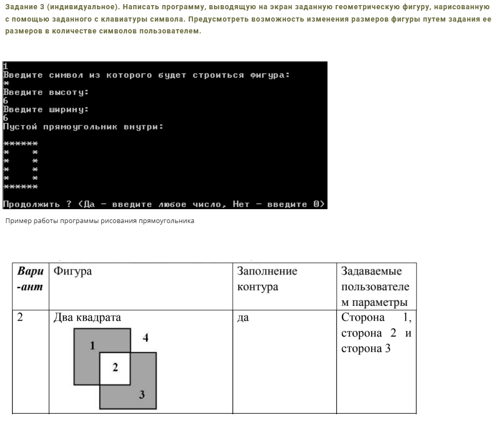
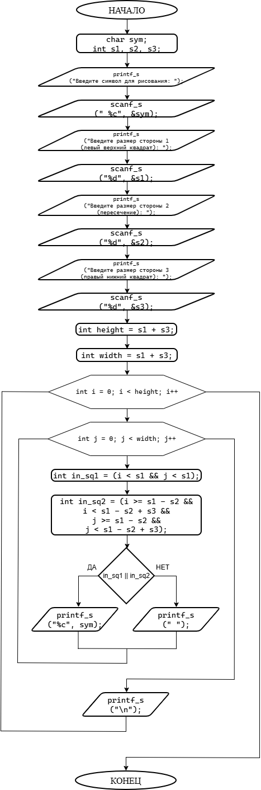
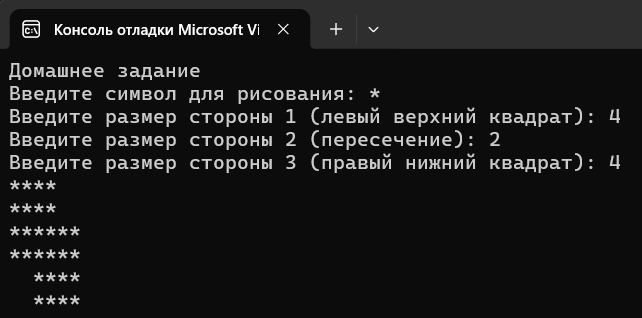

# Домашние задания к работе 9 (Вариант 2) #
## Условие задачи ##



Создать программу, выводящую на экран заданную геометрическую фигуру, нарисованную с помощью заданного с клавиатуры символа. Предусмотреть возможность изменения размеров фигуры путем задания ее размеров в количестве символов пользователем.
## 1. Алгоритм и блок-схема ##

### Алгоритм ###
Алгоритм программы заключается в вводе площади каждой из фигур а также площадь их пересечения и выводом правильно скомпонованной фигуры посредством обработки через счётчик
1. **Начало**
2. Объявляем переменную которую будет вводить пользователь для символа из которых будет созданы фигуры:

```c
char sym;
```

3. Объявляем переменные для размеров сторон квадратов, а также их пересечение:

```c
int s1, s2, s3;
```

4. Попросим пользователя ввести символ из которых будут состоять фигуры, размер левой верхней стороны первого квадрата, пересечение, и размер правой нижней стороны второго квадрата:

```c
printf_s("Введите символ для рисования: ");
scanf_s(" %c", &sym);
printf_s("Введите размер стороны 1 (левый верхний квадрат): ");
scanf_s("%d", &s1);
printf_s("Введите размер стороны 2 (пересечение): ");
scanf_s("%d", &s2);
printf_s("Введите размер стороны 3 (правый нижний квадрат): ");
scanf_s("%d", &s3);
```
**Пробел в `%c` — это важно. Без него `scanf_s` прочитает enter, оставшийся в буфере после предыдущего ввода, и `sym` окажется символом перевода строки. Пробел в формате заставляет `scanf` пропустить все пробельные символы перед чтением**

5. Объявляем переменные для высоты и ширины, чтобы узнать границы области создания фигур:

```c
int height = s1 + s3;
int width = s1 + s3;
```

6. Формируем циклы создания по строкам и столбцам и выводим фигуры:

```c
for (int i = 0; i < height; i++)
{
    for (int j = 0; j < width; j++)
     {
        // Условие для первого квадрата (0,0 до s1,s1)
        int in_sq1 = (i < s1 && j < s1);

        // Условие для второго квадрата (смещенного)
        // Координаты смещения зависят от того, как именно должны пересекаться квадраты
        int in_sq2 = (i >= s1 - s2 && i < s1 - s2 + s3 && j >= s1 - s2 && j < s1 - s2 + s3);

        if (in_sq1 || in_sq2)
        {
            printf_s("%c", sym);
        }
        else
        {
            printf_s(" ");
        }
     }
    printf_s("\n");
}
```
**Внешний цикл идёт по строкам (i), внутренний — по столбцам (j). Это стандартный способ рисовать «картинку» посимвольно: для каждой клетки холста решаем, что там напечатать — символ или пробел.** <br>
**Первый квадрат. Занимает область от (0, 0) до (s1-1, s1-1), то есть прижат к левому верхнему углу. Точка внутри него, если и строка, и столбец меньше s1** <br>
**Второй квадрат. Его левый верхний угол находится в точке (s1 - s2, s1 - s2), а сторона равна s3** <br>
* Логика такая: если квадраты должны пересекаться на величину s2, то второй квадрат «наезжает» на первый на s2 строк и столбцов, поэтому его начало смещено на s1 - s2. Зона пересечения — как раз s2 × s2
* Если точка принадлежит хотя бы одному квадрату — печатаем символ, иначе пробел. Знак || как раз и даёт объединение двух фигур: область пересечения просто закрашивается символом один раз
* В конце строки — `printf_s("\n")` для перехода на новую строку

7. **Конец**

---

## Блок-схема ##



[Блок-схема алгоритма программы, созданной в draw.io](https://viewer.diagrams.net/?tags=%7B%7D&lightbox=1&highlight=0000ff&edit=_blank&layers=1&nav=1&dark=auto#R%3Cmxfile%3E%3Cdiagram%20name%3D%22%D0%A1%D1%82%D1%80%D0%B0%D0%BD%D0%B8%D1%86%D0%B0-1%22%20id%3D%22Z_DNZ6W32sM9It6xY6CX%22%3E7V1bc6M4Fv41rup%2BCKULAvyYOMnsTk1PdU3P7mzvS4rYxKaDjRuTTjK%2FfiSQAAlsYwwE0nKlCAhJCOnjfDrn6DLBs%2FXLL5G7XX0KF14wQWDxMsHXE4SgNXXoPxbyykMgQWnIMvIXaRjIA774f3s8ogh98hfejoelQXEYBrG%2FlQPn4WbjzWMpzI2i8FmO9hAGCylg6y69UsCXuRuUQ%2F%2FyF%2FEqDXWQnYf%2Fy%2FOXK%2FFk%2BsrpnXt3%2FriMwqcNf17AIl0s3OjxwwTh2%2BQ3QbPs%2FGOabO2KZ%2FAK2K3cRfhcCMI3EzyLwjBOz9YvMy9glS5X5%2B2eu9n7RN4mrpPg15v%2F4B83v8HVw3%2BjHVn9mO0etxcVufCgXfwqqm4XR%2BFjVmu04FereB3QU0hP6WttWbz1y5Ihx3gIwuf5yo1iYxfT4x2L87zyY%2B%2FL1p2ziM80Gg178INgFgZhRIOOVyl9TlKI6hQg%2BaUp0nOW4iHcxLfu2g8YZP%2F01xR9CPzuPdPjH%2BHa3fAop2bJoQ0tep1W1Q83eOJVNbkGk%2Bl1cgTseGnn59Or5HjDE3lR7L0Uqpy32i9euPbi6JVGWRXwiHGa7DnHLnQ4snguGJnpNf9ECf94%2BIezzDLOQUJPOE5OwAz%2F7r1F6YMrgyh8iubecfwVwOZtFpfsc6dX88Dd7fy5jLfkS%2FRY%2BQC98l78%2BH%2Fs3CD86iuPx86vXwrRrl8LF5%2B9iAIi9iIedjq66KtGr4VHs8uv4gnsIn94ciWezkWfGy09Xlffn17%2Fuvv7%2Bfu%2Fv3211j%2F%2B%2F7j9Nf5yQcrQOooRwvEQeYEb%2Bz%2Fk1ikAR8SrQgZ%2FwufQp02ZQYvYyEBTCV1YgVfa1DxdUQwdz8rBBrbl3NL6KeWW4DV7%2B%2BYQtmqJPS7ZaCw3CLwgpAJurQi%2FkmTcFoAlJSwgrlIe5rhmGbvRXMgZlusuPQcGwr2JzoZy0akUi8gKYlY7kSfVsfX9idFfkv7igcvqywljMstds2rhEWbubu4ufJfe%2BhRuQvV28kyQ5JJWFcvD2ia3sofQsyX%2F339hbIPsKc42oiB%2FuNuJYt1H4s4HEbTbUraqKmrly4kQRjYJIV2lR5IczeToTCjMHBFOX5FdQnGLHmeFhDfJ8SqJluVwlSS5FWlBIVtYSJXmkN69LsS5zao2f4Eg%2FX%2Bbvm76Ph%2FlW0mbyc2ohrZDrhiBTEzxjBDBktiCbTDsIeF%2FWDzJAqNKpBQElXu%2FC4On2LvM5YosZcxKacafUWRLOEgB5NJIG9ZloBWWiNjjPbW3kAIQDUkmQbBXKDWQPKzTv%2BcjZjm8rgvZ5jKuwYOSPsHe58AEGmCH%2BH%2F8RgLkWO%2Fc6kp4WM2654cEUa%2Fd89OFxaC6yiaU2xnaShZ1O8qljJBpEKerbnJl80MATwDTsEFS1NeQpLFdAAOA6RG1LblStcZhA08FS2PgOahn1CGtnnWlniXlHUZnaDqSvhDNbLNXP8vi0lIQrv0UQmfF4qVH2hPqR6kBjZQaB3fUL4EAazIZD5kQCRYIKrCoTyZKRt1Z%2Bvagrpatj31b%2FtwNfnPvveBzuPNjP2T65H0YxyFjFRHhkiuacaho2IKOVt6Lu2RpJa7hoVmbI4lELIlDbHoVJOVQ1O4GRHEiFVVi8GTJY5UlDxJ9CCF2bGyA4s%2BSUGLZZmdSyK6DB%2Fq6sdy%2BVZ0CuUE24cZT6pwHlawTKprW%2FmLBHq0Is1N5fti8nsoFnz2FlQGkQi8NEPly8svgxCNcJX9dUiNFpGFDCaO0Yg2lK2w5065wibDu9GqfhPZJKD4JUPAf2AXPBOF3c9dFlvamkPBGOB5oCKsBWPVG3J2RFQfx6Ox8OuFeDyQ9lh2J7NQoRr4s%2BT5M%2BW1YYT8OygViNdEWSr25FuWhqbWF8WgLMk3S3l1TbUHJaNqztoBqud40C2vT04BMT2RxzOQEB2xxQlNnv7w5k0NO8YVpDhkUh2DUkvsCi4HKvXFILQuD5hCtyWlNrrkmh6reiEW5lRW17BwWzu1CkYsKHHkHOhkmnXlwhEjWfDpCPlVNl0351FRdQZ3z6VTzqdbJ3p1Ohgask5W%2B8fY4RBRIc8j4OMQ0W7LrmVbPdj1cb6Kj5hCtk2mdrLFOhg%2FoZMrTKn1sRVXM0t410%2BrMMoqRZuGxsjAByuCopixMVBNr5yysx7hoTe79aXJ4wJpc6RtvkUP0CI3xckhbk4NI35ODsJ4crSdHvy1vpB8E%2F3DFaGY28Rgkw5R7mnNcIRfKc47x4Y%2B1RTLQQy1GSwYWaMmsZ6G%2BzXq1hlpoMtBk0DEZpN%2Fj23FBg%2FUn1G%2B1RS7QwwTGywVqFo25QJ3C1zkXTDXqxoo6G7dk0rT7XiHFBHVApqcX9z29GB2GRXtkZ9aSMno%2BcVfzib9lvS4%2Bn%2Fhb8bFiPjHHCr9%2F9WbTieXFEGx1nlSLsNQOvtGyoQNbMs46AgW9sWEtB5%2FWx7U%2B3rE%2B7m%2Fudt9hRg0fKheZ4Gq65MwrXVbzSU8z6irECxKDQrKujrKYtjpGr0VO0Q6%2F8XKK1ZKG5Th9a1ja4ac5ZTCcgvZwSlru3Pp7MUnXID7KL%2BrYk%2F1MVciSW5ZPz%2F1bJ2XeQ5FVZe6FNu0GtNndyk6mdo2OljanlpJFU9qcOj2bw816s9Cbbe208Ob%2BLjFh1rBjdWFJPNuSlSsI9oz95eK9gbyBoGwBysKE%2BcfCCiC666ef7X%2Fjdsa90mbhPbhPQZyYs6%2By%2FdFEg6RbsXEjs7tY%2BJtlkg4B8zypA4sSp7Dv0uni5uj%2BS9n3MxDBRAAyoC0hCALcdNyGQ5SciMJ%2BnUuns511A4Uo%2BHkhipFtqLhqjFDRXctysqx%2BESre%2F%2Bfw67CZYybfqrAJA1a5QLDMf8JTmrWoOuqsPQIUK%2F78PG2XbjmZzPe7bNaHqZpeIPdgTKUH02kL9rFW%2FMh3msGo1B9ARsNdGct5OU6HmzLuafQ%2B7Msjb3QiNkdpodHLedFGd%2FpudL3i5sDmBJ5uj92fghWGJnlw53KKsoH21A3oVOutuX2pLMnhyfb5LL%2B5OsuvvE%2BLvNXcieU7vtfenifQ4LQWD5tJWzOeijEDRVsGUYynpio4pgcE2Zk9Ab1Xr5YPby8fCgtJ1JAKA%2FxmTaT23jv8Zu0TOnLH9qDMegijsAPlbhgsOWIMgMR1%2FV3pB9XzxEQx7sCmq7xjZBnqtmPQwgbo28TzXu3kBbtj5gU8YISc1LQ3CioeCCBL6gvDELGaYdK0sWq8hH3PYCHvzCg%2BKLQwoQMcFTCoMWCYQ4bAtxdiwkGtQdPJcABsmHYZNKqRpP6ogIr8nKlBepY01tn7OmvQ7AUNgna5e%2BM4Bmi8ADM2plYZNID0DBqkQdMdaBAwxLpuYnaQYze17CKoMh3Fn7oufOd4OcWHc1QLFO7DMSAr0wILGmA%2BMK9a%2FxsWGk1AeQrkP1mc2arpoDYukewEtvseTC5Gwb8XGTZ6pFnKzr8lRNTujxNVevYNLfK%2BoDU0mLRIjxYghq1o%2B5QyDbNv3e0UO6mGzKm6G1XQbbWRGypuDDEmzvkQlvLNuui9gUevslO8GrTtPNtP42wglnMSC1D0hju9HY92yL65Q5bMNmP3yGJc%2BpTRfsFynkfW1lbiTnsaSkOqk73qS3clJwyB0fdeObY2DneHFUi1FrPUxo3RYphomv9IGTx990rFwlsaPF2AZ1o2EgNkNN3ZETpOGTDqmP7OAdOqlVhYk8YArdHb7tRV9qymZuEE17JKbQNs4J4dXGK8h5ZdXVjwCDRUE23TjYyIMhStlFHnSNG23m6RUmK5hkipyAtiYhtW36Ll7DVANGAO6F%2FQEBPKC43cHDGkAjG9d6TP9g1o8%2B6bGQAao6%2Bck9Ozedd26sCs4boxO1r6%2BG7fVOt%2BTLO3fN2w6z8poHb0tX73nunxj3Dtbs603lYvrcZmZidblk5vSnO1xYjqE%2Bdq19nuoQQktB%2FWe4yL9DIKmYU1Rxhr0E%2FhwmMx%2FgE%3D%3C%2Fdiagram%3E%3C%2Fmxfile%3E)

---

## 2. Код программы ##

Ниже приведён код для Задания, сделанный на языке С(си).

```c
int HomeWork()
{
    char sym;
    int s1, s2, s3;
    puts("Домашнее задание");
    printf_s("Введите символ для рисования: ");
    scanf_s(" %c", &sym);
    printf_s("Введите размер стороны 1 (левый верхний квадрат): ");
    scanf_s("%d", &s1);
    printf_s("Введите размер стороны 2 (пересечение): ");
    scanf_s("%d", &s2);
    printf_s("Введите размер стороны 3 (правый нижний квадрат): ");
    scanf_s("%d", &s3);

    // Примерная логика отрисовки:
    // Размеры холста должны быть достаточными для размещения фигур
    int height = s1 + s3;
    int width = s1 + s3;

    for (int i = 0; i < height; i++) {
        for (int j = 0; j < width; j++) {
            // Условие для первого квадрата (0,0 до s1,s1)
            int in_sq1 = (i < s1 && j < s1);

            // Условие для второго квадрата (смещенного)
            // Координаты смещения зависят от того, как именно должны пересекаться квадраты
            int in_sq2 = (i >= s1 - s2 && i < s1 - s2 + s3 && j >= s1 - s2 && j < s1 - s2 + s3);

            if (in_sq1 || in_sq2) {
                printf_s("%c", sym);
            }
            else {
                printf_s(" ");
            }
        }
        printf_s("\n");
    }

    return 0;
}
```

---

## 3. Результаты работы программы ##

Для **Задания**



---

## 4. Информация о разработчике ##
**Четверня Данил, БТИИ-262**
